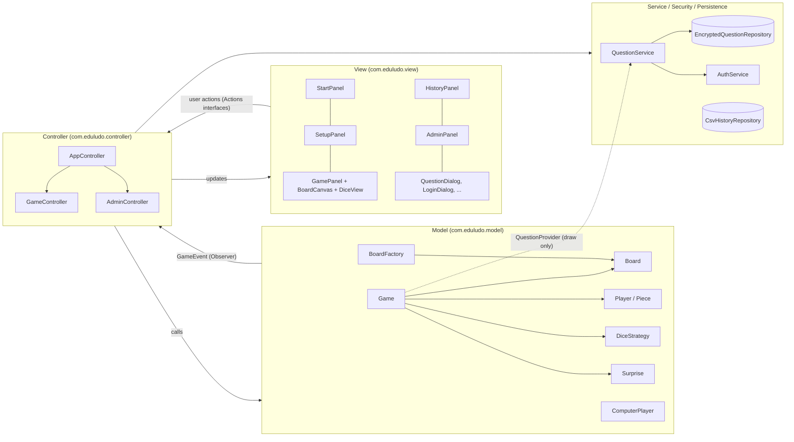
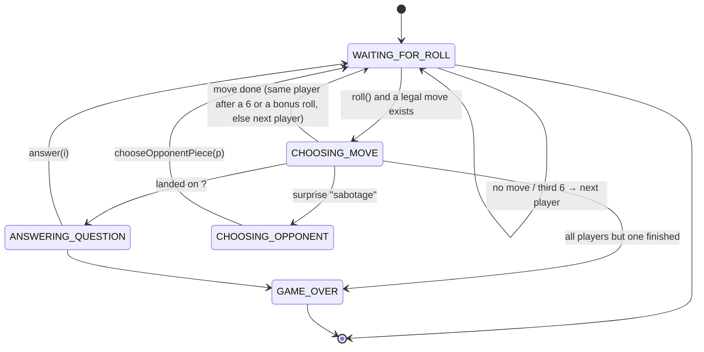
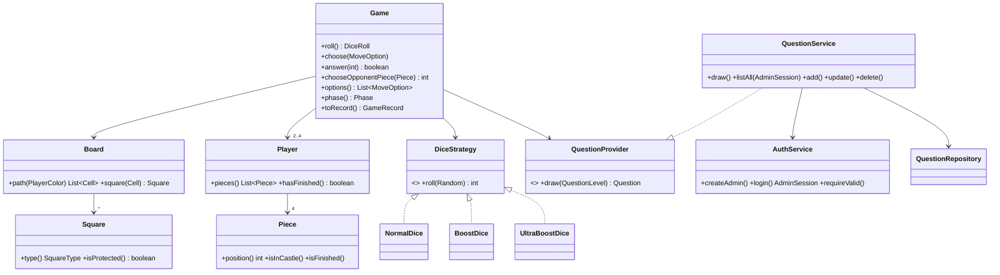

# Architecture

## 1. MVC layers

| Layer | Responsibility | Depends on |
|---|---|---|
| **Model** (`model`) | Board geometry, all game rules, turn state machine, computer decisions. No Swing code. | nothing (pure Java) |
| **View** (`view`) | Drawing and input. Each screen exposes an `Actions` interface for its user actions. Reads the model to draw. | model (read only) |
| **Controller** (`controller`) | Receives user actions, calls the model, plays the computer seats, switches screens, saves history. | model, view, services |
| **Service / security / persistence** | Question access rules, admin login, encryption, files. | model records |

The model is fully tested without a UI (63 automated tests). The views never change the model directly.

## 2. Design patterns

| Pattern | Where | Why |
|---|---|---|
| **Model–View–Controller** | the packages above | separates rules, drawing and flow; the rules can be tested without a window |
| **Factory** | `model/BoardFactory` | builds the EASY / MEDIUM / HARD board (geometry, fixed squares, random squares) in one place |
| **Builder** | `Game.Builder` | creates a game step by step and validates the setup (2–4 players, unique colours and names) before the object exists |
| **Strategy** | `model/dice/DiceStrategy` → `NormalDice`, `BoostDice`, `UltraBoostDice` | the engine rolls "a die" without knowing which; tests plug in a scripted die |
| **Strategy** | `model/Surprise` (each constant has its own `apply`) | each surprise effect is a separate algorithm with its own probability |
| **State** | `model/Phase` + `Game.requirePhase` | each action is only legal in one phase (roll → choose → answer…); illegal calls throw |
| **Observer** | `GameListener` / `GameEvent` | the model announces what happened; the controller updates the log, dice and board |
| **Repository / DAO** | `QuestionRepository`, `HistoryRepository` | storage is hidden behind interfaces; the course's history schema can be plugged in by adding one class |
| **Protection Proxy / Facade** | `service/QuestionService` | the only gateway to the bank; checks the admin session before any sensitive operation |
| **Composition Root (manual Dependency Injection)** | `App.java` | all objects are created and connected in one place, so every class receives its dependencies and can be tested alone |

*Singleton was deliberately not used*: global instances make testing harder. One instance of each service is created
in `App` and passed to whoever needs it.

## 3. Board model

All three boards are built from one red layout that is rotated 90° for every other colour, so the board is fair.

| Level | Grid | Shared tracks | Path length per colour | Arrows |
|---|---|---|---|---|
| Easy | 15×15 | 52-square loop | 51 + 6 home = 57 | 4 (loop → home path) |
| Medium | 17×17 | 64-square ring + 52 loop | 58 + 1 + 51 + 6 = 116 | 8 (ring → loop, loop → home) |
| Hard | 19×19 | 72 ring + 64 ring + 52 loop | 72 + 58 + 1 + 51 + 6 = 188 | 12 |

A piece's position is just an index into its colour's path (`-1` = castle, last index = finish).
Arrows are therefore automatic: after a colour's arrow square, its path continues on the next inner track.

## 4. Turn flow

## 5. Main classes

## 6. Error handling

- Illegal game actions throw `IllegalStateException` / `IllegalArgumentException` (tested).
- A damaged or tampered question file is detected on start; the user may restore the defaults.
- A damaged history line is skipped instead of losing the whole history.
- Any unexpected error is written to `error.log` and shown in a message instead of a silent crash.
