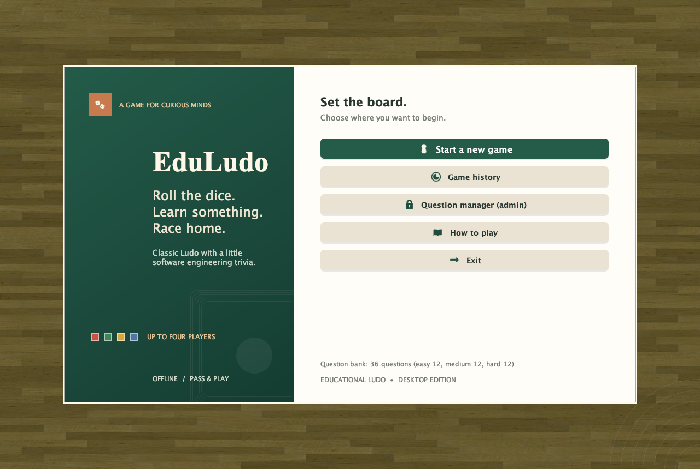
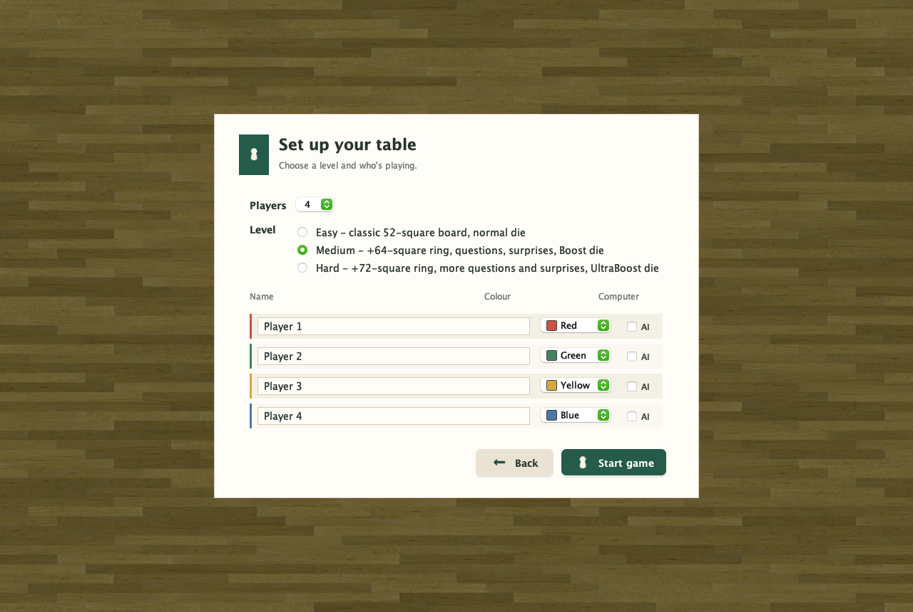
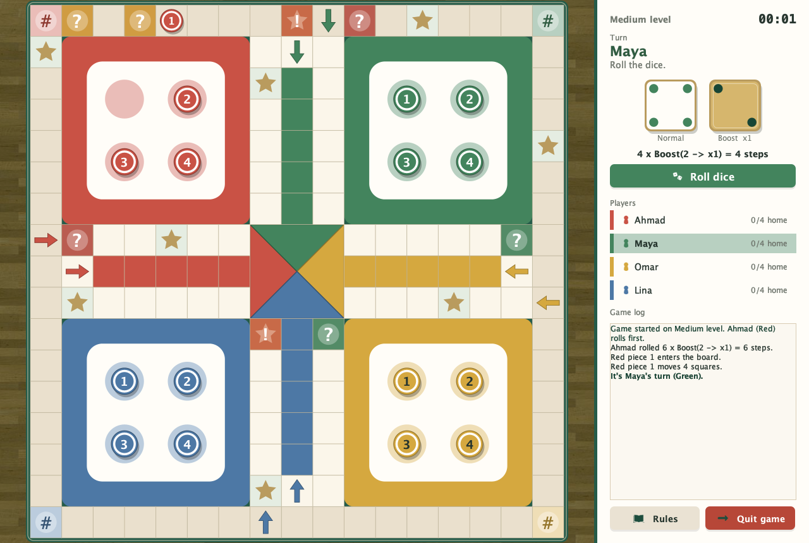
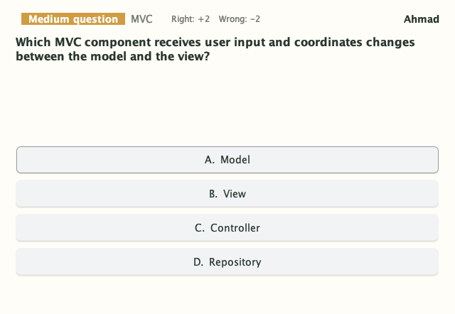
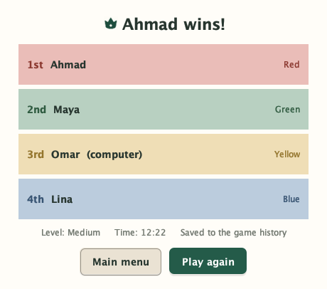

# Educational Ludo Game System — Interactive Prototype

**Group:** python 
**Course project:** Educational Ludo Game System 
**Submission:** 01 November 2026 
**In-class demonstration:** 02 November 2026

## Team

| Member | Student ID | Iteration 1 role |
|---|---:|---|
| Ahmad Khawalid | 212865513 | Scrum Master and Lead Developer |
| Kasem Hilf | 213031289 | Product Owner and Developer |
| Mohamad Amara | 214578007 | Core Backend Developer |
| Omar Ahmad | 212279632 | UI / Frontend Developer |

## Tools and rationale

The interactive desktop prototype was built using **Visual Studio Code**, **Java 17 with Swing** for the desktop interface, and **Figma** for interface exploration. Building the interaction in the target desktop environment made it possible to validate component layout, rendering responsiveness, and button-driven navigation before full backend integration. Figma supported early layout and visual-flow exploration; the Java prototype demonstrated the intended desktop interaction. The prototype uses representative interface content and focuses on the selected user journey rather than production game logic or persistent data.

## End-to-end user journey

The demonstration follows a new game from entry to completion. The presenter should allow a user to operate the prototype through the buttons and screen transitions without first explaining the interaction.

1. **Main Menu:** The user chooses to start a new game.

   

2. **Game Setup:** The user selects the player count, enters player names, assigns colours, and chooses a difficulty.

   

3. **Game Board:** The board screen presents the players, current turn, dice control, and selectable game pieces.

   

4. **Trivia Modal:** When the journey reaches a question square, a modal displays a course question and answer choices, followed by visible feedback.

   

5. **Results Screen:** At the end of the demonstrated flow, the results screen presents the finishing order and a route back to the main menu.

   

The [complete PNG screenshot set](screenshots/) also includes move selection, trivia answer feedback, game history and rankings, the question manager, admin password setup, question editing, and the rules dialog. The screens show the actual application interface; the player names and completed-game records are illustrative demo data.

## Access

**Public Link: N/A - Interactive desktop prototype developed locally in VS Code (Java Desktop Application). Full interactive demonstration provided during in-class session on 02.11.2026.**
